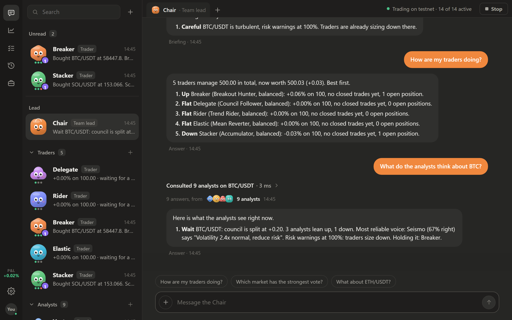
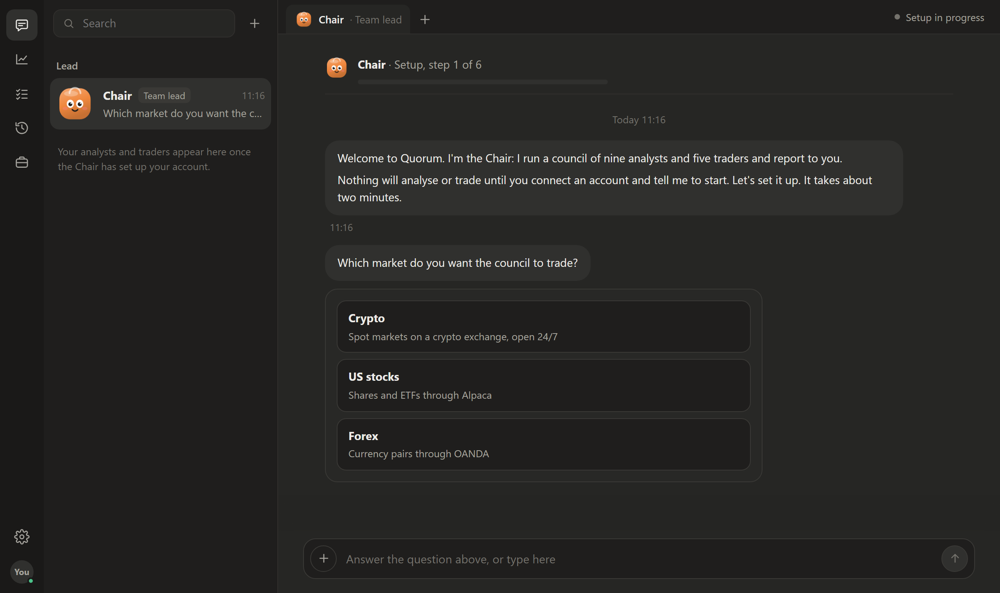
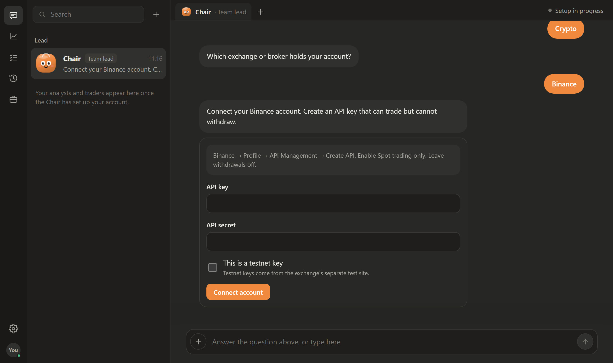
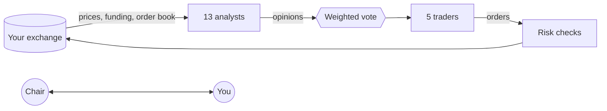
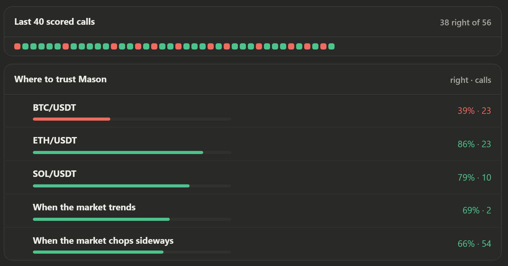
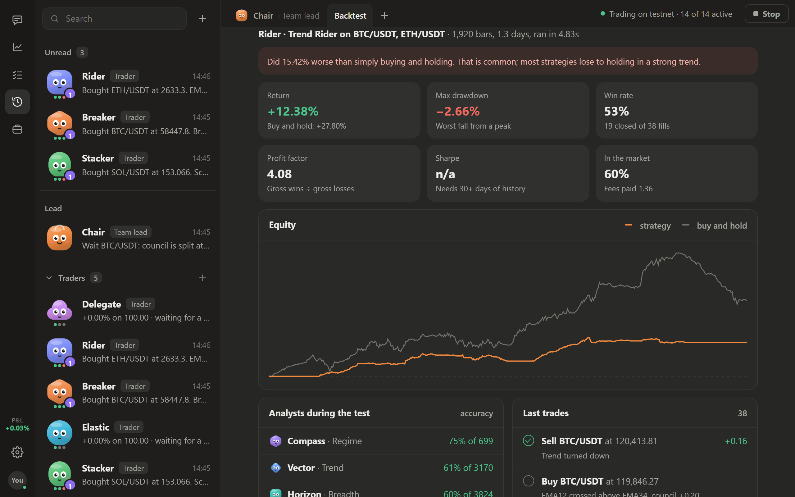
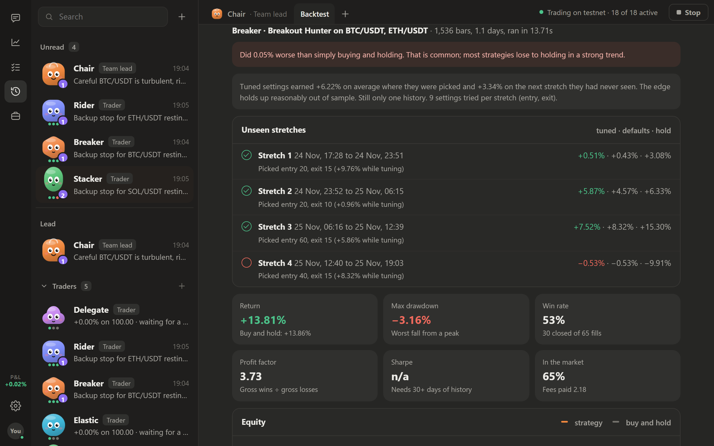
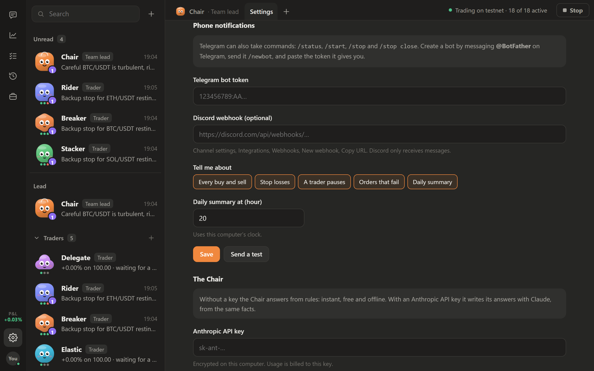

<div align="center">


# Quorum

**A trading bot that works like a small team.**<br>
Thirteen analysts watch the market, five traders act on budgets you set,
and a lead called the Chair keeps you in the loop, on your screen or your phone.

<br>


[](https://github.com/DushaneW/trade-bot-AI/actions/workflows/ci.yml)

[Install](#install) &nbsp;·&nbsp; [First run](#the-first-five-minutes) &nbsp;·&nbsp; [How it works](#how-it-works) &nbsp;·&nbsp; [Safety](#keeping-your-money-safe) &nbsp;·&nbsp; [Backtesting](#testing-ideas-on-old-data) &nbsp;·&nbsp; [Phone](#on-your-phone) &nbsp;·&nbsp; [24/7](#running-it-around-the-clock) &nbsp;·&nbsp; [FAQ](#questions-people-ask)

</div>

<br>



<br>

Most trading bots I tried were one strategy behind an on/off switch. When it worked, great. When it didn't,
you had no idea why, and it kept going anyway.

Quorum is a team instead. The analysts only give opinions, and every opinion is checked later against what
the price really did, so the ones who are right more often get a louder vote. The traders each get their own
budget and their own limits. The Chair sets everything up with you in a chat, tells you what's happening and
never touches your money without a click from you.

It runs on your own computer, your keys stay encrypted on your machine, and nothing trades until you say start.

<br>

<div align="center">

</div>

<br>

<table>
<tr>
<td width="33%" valign="top">

**13 analysts**

Trend, momentum, volatility, volume, support and resistance, futures funding, the order book and more.
They never trade. They just say what they see, and get scored on it.

</td>
<td width="33%" valign="top">

**5 traders**

Each has its own style, budget, stop loss and loss limits. They listen to the analysts' vote and decide
when to buy and sell.

</td>
<td width="33%" valign="top">

**1 Chair**

Your contact. It sets things up, answers questions in plain English, sends you briefings and suggests
changes you can approve with a click.

</td>
</tr>
</table>

<br>

## Install

You need **Python 3.10 or newer**. The installers below check for it and tell you what to do if it's missing.

Get the code first, either with the green **Code → Download ZIP** button on GitHub (then unzip it) or with git:

```bash
git clone https://github.com/DushaneW/trade-bot-AI.git
```

### macOS

1. If you don't have Python yet, grab the installer from [python.org](https://www.python.org/downloads/macos/) or run `brew install python`.
2. Open the folder and double-click **`install.command`**.
3. When it says *Done*, double-click **`Start Quorum.command`**. Your browser opens the dashboard.

The first time, macOS may say the file is from an unidentified developer. Right-click it, choose **Open**,
then **Open** again. You only have to do that once.

Prefer the Terminal? `./install.sh` and then `./start.sh` do the same thing.

### Windows

1. If you don't have Python yet, install it from [python.org](https://www.python.org/downloads/windows/) and tick **"Add python.exe to PATH"** in the first screen.
2. Put the folder somewhere with a short path, like `C:\Quorum`. Very long paths can break the install.
3. Double-click **`install.bat`**.
4. Double-click **`Start Quorum.bat`**. Keep that window open while you use Quorum; closing it stops the team.

If Windows shows a blue "Windows protected your PC" box, click **More info** and then **Run anyway**.

### Linux

```bash
sudo apt install python3 python3-venv   # Ubuntu or Debian; use your own package manager elsewhere
./install.sh
./start.sh
```

### Options

All the launchers accept the same options:

| | |
| --- | --- |
| `--port 9000` | Use another port. The default is `8420`. |
| `--no-browser` | Don't open the browser automatically. |
| `--host 0.0.0.0` | Listen on your network. Quorum refuses unless `QUORUM_PASSWORD` is set. |

The dashboard lives at `http://127.0.0.1:8420`.

<br>

## The first five minutes

<table>
<tr>
<td width="50%"></td>
<td width="50%"></td>
</tr>
</table>

The first time you open Quorum there are no accounts and no bots. The Chair greets you and asks:

1. **What do you want to trade?** Crypto, US stocks or forex.
2. **Where is your account?** Binance, Bybit, OKX, Kraken, Coinbase, KuCoin, Bitget, Gate.io or MEXC. Alpaca for stocks, OANDA for forex.
3. **Your API key.** It shows where to create one. The key needs to trade but **must not be able to withdraw**. The Chair checks it with the exchange and shows your free balance. The key is stored encrypted and never appears in the chat.
4. **Which markets?** Only pairs the exchange really lists.
5. **How much?** The part of your balance the team may use, say 100 USDT. The rest of your account is never touched. Every trader places real orders, so you confirm that you can lose this money.
6. **Who trades?** The budget is split evenly between the traders you hire. With a small budget the Chair suggests fewer traders, so every order stays above the exchange minimum. With 100 USDT on Binance it picks four.
7. **How careful?** Careful, Balanced or Bold. This sets stop losses, position sizes and loss limits, and you can change it per trader later.
8. **Start.** The team is ready but waits until you press *Start the council*.

After that, type `start` or `stop` to the Chair or use the button at the top. Stopping asks whether to keep
your positions (their stop losses keep working) or close everything.

> **Want to practise first?** Use a testnet key. For Binance, sign in at `testnet.binance.vision` with GitHub
> and generate one. The exchange gives you fake money and everything else works exactly like the real thing.
> Tick *This is a testnet key* when you paste it.

<br>

## How it works



Every time a candle closes, each analyst gives an opinion on every market. Older opinions are scored against
what really happened, and the vote is updated. Each trader then looks at its own setup plus the vote and
decides whether to act. Before anything reaches the exchange, the risk manager checks it against that
trader's limits. Fills are booked in the trader's own ledger, so no trader can touch another one's money.

### How the analysts get smarter

An analyst isn't simply "good" or "bad". Quorum keeps a separate record for every analyst on every market,
and for two kinds of market mood: trending and choppy.



Mason above is right 86% of the time on ETH and only 39% on BTC, so its vote carries a lot of weight on ETH
and very little on BTC. New records start close to the analyst's overall score and earn their own weight as
calls pile up, so a few lucky guesses can't take over.

Vector also reads two charts at once, the one you trade and one twelve times longer, and speaks up louder when
both agree. And traders size their entries by how united the team is: a split vote means a smaller position,
a unanimous one a slightly bigger one.

On crypto, three analysts look past the chart. **Carry** reads the futures funding rate: when longs pay a lot to
stay in, the trade is crowded and tends to unwind. **Crowd** compares open interest with the price move, which
tells new money apart from short covering. **Depth** weighs buy orders against sell orders near the price. Order
books can be faked, so Depth speaks softly and the scoring decides how much it is worth.

You can see all of this on each analyst's page under *Where to trust*.

<br>

## The team

<table>
<tr>
<td width="50%" valign="top">

**Analysts** · they only give opinions

| | |
| --- | --- |
| **Vector** | The trend |
| **Tempo** | Momentum, overbought or oversold |
| **Seismo** | Volatility, warns when it gets wild |
| **Horizon** | How many markets rise together |
| **Tide** | Whether volume backs the move |
| **Compass** | Clean trend or just noise |
| **Mason** | Support and resistance |
| **Contra** | Price and momentum disagreeing |
| **Ranker** | Which market is strongest |
| **Link** | Markets that move together, and which one lags |
| **Carry** | Futures funding: who is crowded |
| **Crowd** | Open interest behind the move |
| **Depth** | Buy and sell orders near the price |

Carry, Crowd and Depth join crypto teams only.

</td>
<td width="50%" valign="top">

**Traders** · they buy and sell

| | |
| --- | --- |
| **Rider** | Follows trends when the team agrees |
| **Elastic** | Buys sharp drops, sells the bounce |
| **Breaker** | Buys breakouts to new highs |
| **Stacker** | Buys a little at a time, takes profit |
| **Delegate** | Only trades on a strong team vote |

Every team member is a little character in the dashboard. They blink, follow your cursor, hop when they
trade, look happy or worried depending on how they're doing, and fall asleep when the team is stopped.

</td>
</tr>
</table>

<br>

## Keeping your money safe

I'd rather the bot miss a trade than blow up an account, so a lot of Quorum is limits.

Each trader has a **budget** it can never exceed, a **stop loss** per position (checked even while the team
is stopped), a **daily loss limit**, a **drawdown limit** after which it waits for you, and a **cap per market**.
The risk profile sets them for you:

| | Stop loss | Max per market | Daily loss limit | Drawdown limit |
| --- | --- | --- | --- | --- |
| **Careful** | 3% | 35% | 6% | 20% |
| **Balanced** | 4% | 50% | 10% | 30% |
| **Bold** | 6% | 80% | 15% | 40% |

You can fine-tune any of them on the trader's page.

**Stops that work while your computer is off.** After every buy, Quorum also places a stop order on the
exchange itself, half a percent past the trader's own stop loss. Normally the trader's stop acts first and
the backup is cancelled. If your laptop sleeps or the internet drops, the exchange closes the position anyway,
and Quorum books that sale the next time it starts. On Binance this is a stop-limit order with 1% room to fill,
because Binance spot has no plain stop-market order. You can turn it off in Settings.

**One bet is one bet.** BTC, ETH and SOL often move together, so holding all three is close to one big position.
Quorum measures how closely your markets move together, and when a trader already holds markets that move like the
one it wants to buy, the new position is trimmed. The cap is 50%, 80% or 140% of the trader's money in
look-alike markets, depending on the risk profile.

And a few rules that can't be switched off:

- Nothing runs before you press Start.
- The team only ever uses the budget you gave it. The rest of your balance is never touched.
- Keys that the exchange says can withdraw money are refused.
- If you mark a key as testnet and the exchange has no testnet, Quorum refuses instead of quietly using your real account.
- Orders below the exchange minimum are raised to the minimum when the trader can afford it, and skipped when it can't.
- When an exchange takes its fee in the coin you bought, Quorum books the smaller amount you really hold, so selling never fails for want of a few satoshis.

<br>

## Testing ideas on old data



Open **Backtest** from the left bar, or press *Backtest* on any trader. It replays up to 5,000 candles of real
history through the exact same analysts, vote and risk checks that run live.

It tries hard to be honest. Decisions use a candle's close and fill at the next candle's open, so it can't
peek ahead. Every trade pays fees and slippage. Stops are checked against the candle's low. And you always
see the result next to simply buying and holding, which is the number most strategies quietly lose to.

A good backtest means "this idea isn't obviously broken". Try anything promising on a testnet account before
giving it real money.

### Walk-forward



Tick *Walk-forward test* and Quorum splits the history into five stretches. It tries nine settings for the
trader on the first stretch, keeps the best, and trades the second stretch with them, unchanged. Then it rolls
forward. Only the stretches the settings had never seen count toward the result.

If tuned settings earned 10% where they were picked and 1% on the next stretch, the tuning was fitting noise,
and the page says so. Each stretch also shows what the default settings and plain holding would have done.

<br>

## Talking to the Chair

Ask things like *"What about BTC?"* or *"How are my traders doing?"*. The Chair asks every analyst on the spot
(each takes well under a millisecond) and tells you how the vote looks, who agrees, who has been most
reliable lately and which traders hold that market.

Out of the box it answers with built-in rules: free, instant and offline. Add an Anthropic API key in
**Settings** and it writes its answers with Claude instead. It sends a summary of votes and results, never
your exchange keys.

When the Chair thinks something should change, like pausing a trader that keeps losing, it shows a button.
Nothing happens unless you click it.

<br>

## On your phone



Connect Telegram in **Settings** and the team writes to you: every buy and sell, stop losses, a trader pausing,
orders that fail and a short summary each evening. You choose which.

It also takes commands. `/status` shows how the team is doing, `/start` and `/stop` work like the button in
the dashboard, and `/stop close` stops and sells everything.

1. In Telegram, message **@BotFather**, send `/newbot` and follow the two questions.
2. Paste the token it gives you into Settings.
3. Open your new bot and send it the pairing code Settings shows, like `/pair 482913`.

From then on only your chat can give commands; anyone else who finds the bot is ignored. Discord works too,
through a channel webhook, but only for messages, since webhooks can't read replies.

The dashboard itself also works on a phone, with the sections in a bar at the bottom.

<br>

## Running it around the clock

A team on a laptop trades only while the laptop is awake. To keep it going, run Quorum on something that stays
on: an old PC, a Raspberry Pi 4 or 5 with a 64-bit system, or a small VPS for a few dollars a month.

With Docker:

```bash
git clone https://github.com/DushaneW/trade-bot-AI.git quorum && cd quorum
echo "QUORUM_PASSWORD=pick-a-long-one" > .env
docker compose up -d
```

The first build takes a minute or two. After that Quorum restarts by itself after a crash or a reboot, and
keeps its data in `./data` next to the compose file. The dashboard asks for that password.

| | |
| --- | --- |
| `docker compose logs -f` | Watch what the team is doing |
| `docker compose down` | Stop it (backup stops on the exchange stay in place) |
| `git pull && docker compose up -d --build` | Update to the latest version, data included |

On Windows and macOS this needs Docker Desktop, and on Windows also WSL: run `wsl --install` in PowerShell
as administrator once.

By default the port only listens on the machine itself. From your own computer, reach it through an SSH tunnel:

```bash
ssh -L 8420:127.0.0.1:8420 you@your-server
```

and open `http://127.0.0.1:8420`. If you'd rather expose it, put it behind a reverse proxy with HTTPS (Caddy
does this in two lines) and never on plain HTTP.

Without Docker, `QUORUM_PASSWORD=... ./start.sh --host 0.0.0.0 --no-browser` does the same; Quorum refuses to
listen on the network without a password.

<br>

## Where you can trade

| | Exchanges and brokers | Practice accounts |
| --- | --- | --- |
| **Crypto** | Binance, Bybit, OKX, Kraken, Coinbase, KuCoin, Bitget, Gate.io, MEXC via [ccxt](https://github.com/ccxt/ccxt) | Testnet where the exchange has one |
| **US stocks** | Alpaca | Free practice accounts |
| **Forex** | OANDA | Free practice accounts |

Backup stops on the exchange work on all of them. Funding and open interest need the exchange to list a
perpetual future for the pair; where it doesn't, Carry and Crowd stay quiet.

<br>

## Your data

Everything lives in a `data` folder inside the project. It holds the database and `secret.key`, which unlocks
your saved API keys. **Back it up and never share or commit it.** It's already in `.gitignore`. To keep it
somewhere else, set the `QUORUM_DATA` environment variable.

**Settings → Export all trades** downloads every buy and sell as a CSV file with time, price, fee and result,
ready for a spreadsheet or a tax tool. Each trader's page has its own export too.

<br>

## For developers

The dashboard is plain HTML, CSS and JavaScript with no build step. It talks to a small local API you can
browse at `http://127.0.0.1:8420/api/docs`.

```
quorum/
├── install.sh · install.command · install.bat     installers
├── start.sh · Start Quorum.command · Start Quorum.bat
├── run.py                 start it without the launchers
├── Dockerfile · docker-compose.yml
├── strategies/            your own analysts and traders
├── tests/                 one file per module, all on the simulator
├── docs/                  architecture.md, strategies.md
└── quorum/
    ├── engine.py          prices → analysts → vote → traders → risk → orders
    ├── lead.py            the Chair
    ├── onboarding.py      the first-run setup chat
    ├── learning.py        how analysts get scored
    ├── risk.py            all the limits
    ├── ledger.py          each trader's money and positions
    ├── backtest.py        replaying history, walk-forward
    ├── notify.py          Telegram and Discord
    ├── plugins.py         loads strategies/
    ├── bots/              analysts and traders
    ├── connectors/        exchanges and brokers
    └── web/               the dashboard
```

To work on Quorum itself:

```bash
pip install -e ".[dev]"
ruff check quorum tests strategies
pytest -q
```

The tests need no keys and no network. [docs/architecture.md](docs/architecture.md) follows one candle from the
exchange to an order, and [CONTRIBUTING.md](CONTRIBUTING.md) has the house rules.

**Your own analyst or trader** goes in the `strategies` folder, no changes to Quorum needed. Copy
`strategies/_example_analyst.py` to a name without the underscore, edit it and restart, or follow
[docs/strategies.md](docs/strategies.md). A new analyst joins every existing team and gets scored like the
others, so a bad idea simply loses its vote. A new trader appears in the hiring menu and in backtests. Settings lists what loaded and any file that failed. Plugins are plain
Python with full access to your computer, so only use files you have read.

New exchange? Implement the methods in `quorum/connectors/base.py`.

<br>

## Questions people ask

<details>
<summary><b>Will this make me money?</b></summary>
<br>
I can't promise that, and neither can anyone else. Quorum gives you clear rules, an explanation for every trade
and an honest way to measure how it's really doing. Plenty of strategies lose to just holding when the market
rises hard, and the backtest page shows you that plainly. Start on a testnet, then small, with money you can
afford to lose.
</details>

<details>
<summary><b>Can it take money out of my account?</b></summary>
<br>
It's built not to. Create your API key without withdrawal rights. If the exchange reports that a key can
withdraw, Quorum won't use it. Alpaca and OANDA trading keys can't move money out at all.
</details>

<details>
<summary><b>Does my computer have to stay on?</b></summary>
<br>
The team only analyses and trades while Quorum runs. Your open positions are safer than that, though: each one
has a backup stop resting on the exchange, which closes it even if your computer is off. To keep the team
itself working, see [Running it around the clock](#running-it-around-the-clock).
</details>

<details>
<summary><b>Does it send my data anywhere?</b></summary>
<br>
Only to the exchanges you connect, to Anthropic if you turn on the Claude option and ask the Chair a
question, and to Telegram or Discord if you connect them. There's no tracking.
</details>

<br>

## Please read this

Quorum is a tool, not financial advice. Trading is risky, automated trading can lose money faster than you
would by hand, and past results (testnet, backtested or real) don't tell you what happens next. You're
responsible for your accounts, your keys and every order they place.

<br>

<div align="center">
<sub>MIT License. Use it, change it, make it better.</sub>
</div>
